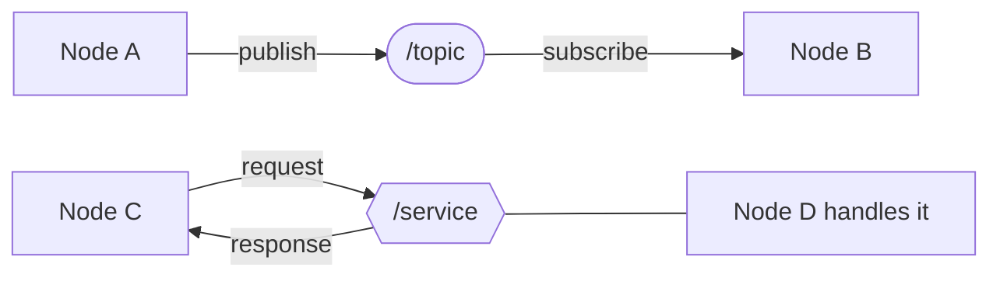
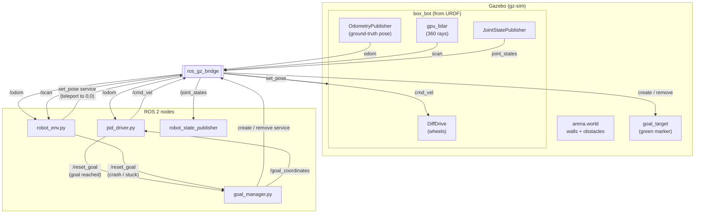
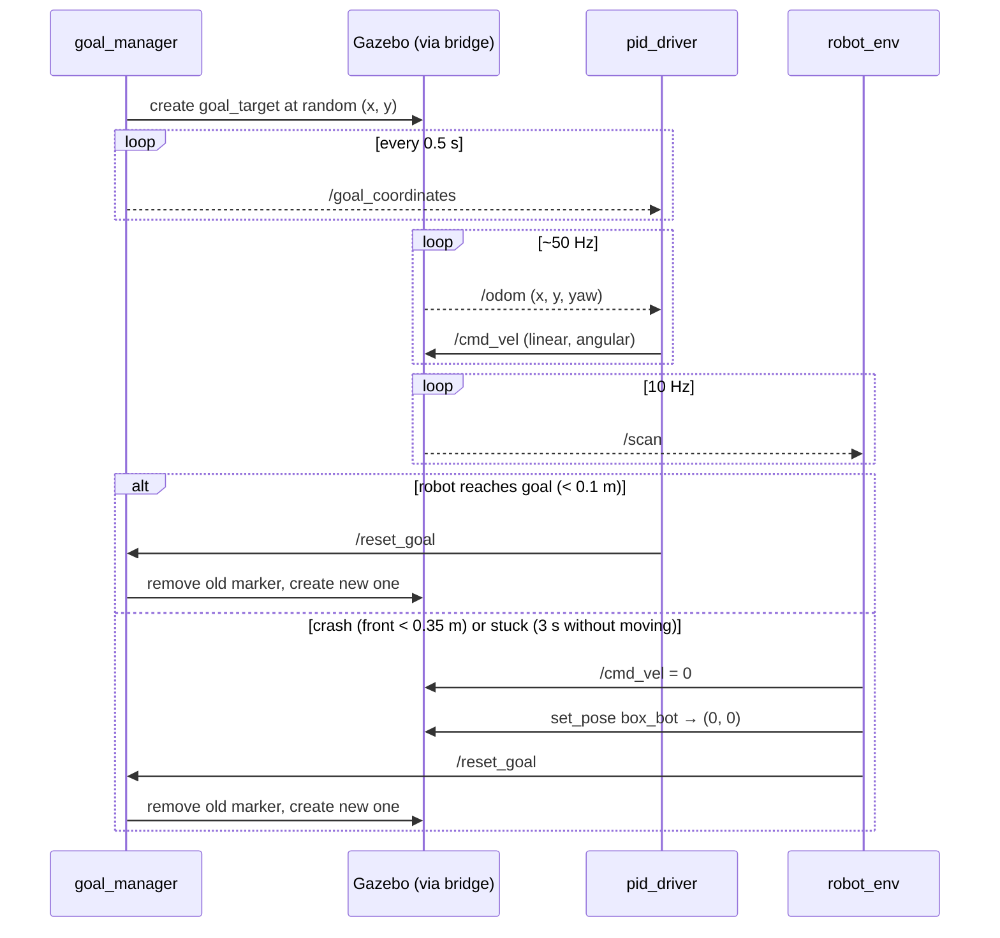
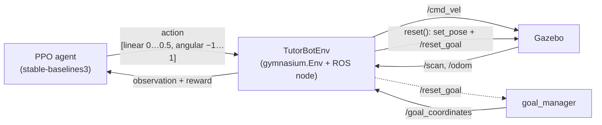
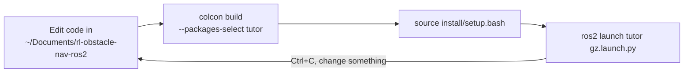

# How This Project Works

A big-picture guide to the ROS 2 concepts used here and how data flows between Gazebo and the nodes in the `tutor` package.

- [1. ROS 2 in a nutshell](#1-ros-2-in-a-nutshell)
- [2. Workspace vs. repository](#2-workspace-vs-repository)
- [3. Arena + PID mode (`gz.launch.py`)](#3-arena--pid-mode-gzlaunchpy)
- [4. RL training mode (`train.launch.py` + `rl_train.py`)](#4-rl-training-mode-trainlaunchpy--rl_trainpy)
- [5. Topics and services reference](#5-topics-and-services-reference)
- [6. Build and run cycle](#6-build-and-run-cycle)
- [7. Inspecting a running system](#7-inspecting-a-running-system)

---

## 1. ROS 2 in a nutshell

A ROS 2 system is a set of small, independent programs (**nodes**) that never call each other directly. They talk only through **topics** (continuous streams) and **services** (request/response).



| Concept | What it is | Example in this project |
|---|---|---|
| **Node** | A small program with a single job | `pid_driver.py`, `goal_manager.py` |
| **Topic** | A named channel; anyone can publish or subscribe, messages flow continuously | `/cmd_vel`, `/odom`, `/scan` |
| **Message** | The data type carried on a topic | `Twist` (velocity), `LaserScan` (lidar) |
| **Service** | A one-off request that gets a reply | `/world/arena/set_pose` (teleport the robot) |
| **Launch file** | A Python script that starts many nodes at once | `launch/gz.launch.py` |
| **Package** | One ROS project folder (`package.xml` + `CMakeLists.txt`) | `tutor` (this repo) |
| **Workspace** | The folder where packages are built | `~/ros2_ws` |

Because nodes are decoupled, any node can be swapped out. The RL agent replaces the PID driver without touching Gazebo or the goal manager: both consume `/scan` + `/odom` and produce `/cmd_vel`.

---

## 2. Workspace vs. repository

The workspace lives **outside** the git repo. The repo is a single package that is linked into the workspace's `src/` folder.

```
~/ros2_ws/                          ← ROS 2 workspace (not in git)
├── src/
│   └── tutor → ~/Documents/rl-obstacle-nav-ros2   ← symlink to this repo
├── build/                          ← generated by colcon
├── install/                        ← generated by colcon (this is what you source)
└── log/                            ← generated by colcon

~/Documents/rl-obstacle-nav-ros2/   ← this git repo (the actual source code)
├── launch/    urdf/    worlds/    scripts/
├── package.xml
└── CMakeLists.txt
```

- Editing files in the repo edits what colcon sees, since `src/tutor` is a symlink.
- `colcon build` **copies** scripts, launch files, URDF and worlds into `install/`, so you must rebuild after changes. Use `colcon build --symlink-install` to skip that for edits to existing files.
- `rl_train.py` writes `models/` and `training_logs/` into the **current directory** you run it from.

---

## 3. Arena + PID mode (`gz.launch.py`)

### 3.1 What gets started

| Process | Package | Role |
|---|---|---|
| Gazebo (`gz sim`) | `ros_gz_sim` | Physics simulator; loads `worlds/arena.world` |
| `robot_state_publisher` | `robot_state_publisher` | Publishes the robot model (URDF) and static TF frames |
| `create` | `ros_gz_sim` | Spawns `box_bot` into Gazebo from `/robot_description` |
| `parameter_bridge` | `ros_gz_bridge` | Translates between Gazebo transport and ROS 2 |
| `goal_manager.py` | `tutor` | Picks random goals and shows the green marker |
| `robot_env.py` | `tutor` | Detects crashes / stuck robot and resets it |
| `pid_driver.py` | `tutor` | Steers the robot toward the current goal |

### 3.2 Data flow

Gazebo speaks its own protocol (gz-transport), not ROS. Everything crosses the **bridge**.



### 3.3 One cycle, step by step



### 3.4 The PID driver's control law

Every `/odom` message triggers one control step in `pid_driver.py`:

```
distance    = √(dx² + dy²)
angle_error = atan2(dy, dx) − yaw            (wrapped to −π … π)

linear.x    = min(0.5 · distance, 0.4)       m/s
angular.z   = 1.5 · angle_error              rad/s

if distance < 0.1 → stop and publish /reset_goal (once per goal)
```

It is actually a proportional (P) controller with no obstacle avoidance, which is why it crashes into obstacles and why the RL mode exists.

---

## 4. RL training mode (`train.launch.py` + `rl_train.py`)

`train.launch.py` starts only Gazebo, the bridge, `robot_state_publisher`, the spawner and `goal_manager`. **`pid_driver` and `robot_env` are not started.** Their jobs are done by `TutorBotEnv` in `scripts/rl_env.py`, which `rl_train.py` runs in a separate terminal.

```bash
# Terminal 1 (gui:=false runs Gazebo headless, faster for training)
ros2 launch tutor train.launch.py gui:=false

# Terminal 2
source ~/venvs/tutor/bin/activate
ros2 run tutor rl_train.py
```

### 4.1 The training loop



### 4.2 Observation, action and reward

| | Contents |
|---|---|
| **Observation** (12 floats) | 10 down-sampled lidar distances (clipped to 3.5 m), distance to goal, heading error to goal |
| **Action** (2 floats) | Linear speed `0 … 0.5` m/s, angular speed `−1 … 1` rad/s |
| **Step time** | ~0.1 s (`spin_once` timeout) |

| Event | Reward | Episode ends? |
|---|---|---|
| Reached goal (< 0.20 m) | **+100** | Yes (terminated) |
| Crash (front lidar < 0.17 m) | **−100** | Yes (terminated) |
| 800 steps without either | 0 | Yes (truncated) |
| Any other step | `10 × (distance improvement) − 0.5 × │heading error│ − 0.01` | No |

### 4.3 PID vs. RL

| | PID mode | RL mode |
|---|---|---|
| Who decides the steering | Hand-written formula | Neural network learned by PPO |
| Uses lidar for driving | No | Yes (10 rays) |
| Avoids obstacles | No | Learns to |
| Inputs / outputs | `/odom` in, `/cmd_vel` out | `/scan` + `/odom` in, `/cmd_vel` out |

Checkpoints are saved every 20,000 steps to `models/PPO/`, and `load.py` benchmarks a saved model.

---

## 5. Topics and services reference

### Topics

| Topic | Type | Publisher | Subscribers |
|---|---|---|---|
| `/cmd_vel` | `geometry_msgs/Twist` | `pid_driver` / `TutorBotEnv`, `robot_env` (zero on reset) | Gazebo DiffDrive (via bridge), `robot_env` |
| `/odom` | `nav_msgs/Odometry` | Gazebo OdometryPublisher (via bridge) | `pid_driver`, `robot_env`, `TutorBotEnv` |
| `/scan` | `sensor_msgs/LaserScan` | Gazebo gpu_lidar (via bridge) | `robot_env`, `TutorBotEnv`, `lidar.py` |
| `/goal_coordinates` | `geometry_msgs/Point` | `goal_manager` (every 0.5 s) | `pid_driver`, `TutorBotEnv` |
| `/reset_goal` | `std_msgs/Empty` | `pid_driver`, `robot_env`, `TutorBotEnv` | `goal_manager` |
| `/reset_robot` | `std_msgs/Empty` | You (manual reset) | `robot_env` |
| `/tf` | `tf2_msgs/TFMessage` | Gazebo (`odom → base_link`), `robot_state_publisher` | RViz, etc. |
| `/joint_states` | `sensor_msgs/JointState` | Gazebo (via bridge) | `robot_state_publisher` |
| `/clock` | `rosgraph_msgs/Clock` | Gazebo (via bridge) | Nodes with `use_sim_time` |

### Services (bridged to Gazebo)

| Service | Type | Used by | Purpose |
|---|---|---|---|
| `/world/arena/create` | `ros_gz_interfaces/SpawnEntity` | `goal_manager` | Spawn the green goal marker |
| `/world/arena/remove` | `ros_gz_interfaces/DeleteEntity` | `goal_manager` | Remove the old marker |
| `/world/arena/set_pose` | `ros_gz_interfaces/SetEntityPose` | `robot_env`, `TutorBotEnv` | Teleport `box_bot` back to (0, 0) |

> Gazebo's own *Reset* button is not used: it restores the world to its loaded state, which can remove the robot that was spawned afterwards.

---

## 6. Build and run cycle



```bash
cd ~/ros2_ws                              # go to the workspace
colcon build --packages-select tutor      # copy/install the tutor package into install/
source install/setup.bash                 # let this terminal find the tutor package
ros2 launch tutor gz.launch.py            # start everything
```

| Command | Why |
|---|---|
| `source /opt/ros/lyrical/setup.bash` | Loads ROS 2 itself (put it in `~/.bashrc`) |
| `colcon build` | Needed after every code change (unless using `--symlink-install`) |
| `source install/setup.bash` | Needed once per new terminal, so `ros2` can find `tutor` |
| `source ~/venvs/tutor/bin/activate` | Needed before running `rl_train.py` / `load.py` (stable-baselines3 lives there) |

---

## 7. Inspecting a running system

Run these in another terminal while the simulation is up:

```bash
ros2 node list                 # all running nodes
ros2 topic list                # all topics
ros2 topic echo /cmd_vel       # live velocity commands
ros2 topic hz /scan            # lidar rate (~10 Hz)
ros2 service list | grep world # bridged Gazebo services
rqt_graph                      # auto-drawn node ↔ topic graph (GUI)

# Manual resets
ros2 topic pub --once /reset_robot std_msgs/msg/Empty   # teleport robot + new goal
ros2 topic pub --once /reset_goal  std_msgs/msg/Empty   # new goal only
```
